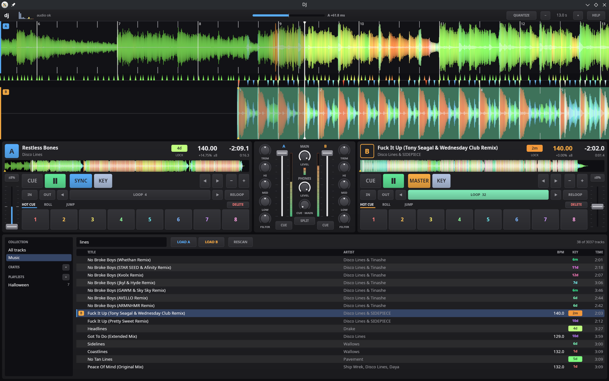

# dj

A standalone two-deck DJ application in Rust. It is developed on macOS/Linux with a
Roland DJ-505 and targets a Raspberry Pi CM5 with a 7″ touchscreen.



## Status

- **Milestone 0 (skeleton):** done. Workspace, CI, a window, and a sine tone through
  `cpal` with the real-time rules enforced.
- **Milestone 1 (one deck):** done. Load a FLAC/MP3/M4A/WAV/AIFF, play, pause and CDJ-style
  CUE from the keyboard. A loader thread decodes and resamples into a buffer allocated up
  front; the track is playable after the first packet (tens of ms) while decoding continues.
- **Milestone 2 (DJ-505, two decks, mixer):** done, but the DJ-505 mapping has only been
  tested against a simulated controller (see below). Two decks; per channel trim, 3-band
  isolator EQ with kills, one-knob low/high-pass filter, channel fader and headphone cue
  (PFL); main on outputs 1–2, cue on 3–4. Tempo is varispeed (pitch follows tempo) until
  key lock lands in Milestone 4. MIDI monitor, and a control thread that connects to the
  DJ-505 whenever it is plugged in.
- **Milestone 3 (waveforms, transient markers):** done. On-screen text; stacked
  scrolling waveforms (low/mid/high bands) with a shared centre playhead, scaled by
  tempo so matched kicks scroll together; overview strips; kick markers detected from
  the audio; and a live phase offset readout between the decks' kicks. Kick markers
  land within ±0.75 ms on synthetic kicks and roughly ±2 ms on real music.
- **Milestone 4 (key lock, tempo, beatgrid, sync):** done. Key lock (on by default)
  through Signalsmith Stretch behind the `TimeStretcher` trait; a constant-tempo
  beatgrid fitted to the kick markers (whole-number BPMs when they fit); SYNC per deck
  with a master deck, phase kept by a small rate correction rather than jumps;
    quantized cue points; fine keyboard tempo (0.02% per press).
- **Milestone 5 (cues, loops, pads):** done. 8 hot cues per deck (a slot holds a cue
  point or a saved loop), loop in/out, auto loops of a chosen length, halve/double,
  reloop, loop rolls with slip, beat jump; all quantized when QUANTIZE is on, and loops stay seamless with key lock.
  Hot cues and saved loops are stored in the library (SQLite) the moment they change
  and come back when the track is loaded again. DJ-505 pads, pad modes and loop buttons
    are mapped, with pad LEDs in the hot cue colours.
- **Milestone 6 (library, browser, offline analyzer):** done, with crates and
  playlists. The library scans `~/Music` (or `--music DIR`) and USB drives as they
  are plugged in, and analyses every track in the background for BPM and key. The
  browser (always on screen under the decks) has search, sortable columns and sources.
  The offline analyzer in `tools/analyze` writes sidecars with neural beats and
  downbeats, which the app imports and prefers.

## Build and run

```sh
# Linux needs ALSA headers: libasound2-dev (Debian) / alsa-lib-devel (Fedora)
cargo run -- track.flac            # window, track on deck A (a second file goes to B)
cargo run -- --list-devices
cargo run -- --device "DJ-505"     # pick an output by name substring
cargo run -- --headless 10 a.mp3   # no window; plays deck A (or the tone) and logs stats
cargo run -- --midi-monitor        # log incoming MIDI and what it maps to
cargo run -- --help
```

### The screen

```text
 top bar: audio health · QUANTIZE · zoom − / + · HELP
 deck A scrolling waveform (full width)
 phase meter
 deck B scrolling waveform (full width)
 deck A panel  │  mixer  │  deck B panel
 browser
```

The two scrolling waveforms always span the window, one above the other, around a
shared centre playhead; each is scaled by its deck's speed so matched beats line up.
They are coloured by spectrum (red bass, green mids, blue highs; `--waveform bands`
gives the layered blue/orange/white style instead), dimmed where already played, with
beat lines (brighter on bars), yellow kick ticks, numbered hot cue flags, the loop in
green and the cue point as orange triangles. The phase meter between them grows towards
the deck whose kicks land first, and says by how many ms, while both decks play.

Each deck panel has the track header (deck letter, title, artist, key in its colour on
the circle of fifths, outlined green when it mixes with the other deck, BPM, tempo and
range, remaining and elapsed time), the overview strip, then CUE (hold), PLAY, SYNC
(MASTER when the other deck follows this one), KEY lock, bend ◂ ▸ and fine tempo − +
(both repeat while held); IN, OUT, the auto-loop length with ◂ ▸ (halves or doubles the
active loop too), LOOP and RELOOP; pad modes and the eight pads; and a vertical tempo
fader on the outer edge (up is slower, as on a CDJ) under its range button. The mixer
has trim, high, mid, low and filter knobs, a fader, a meter and headphone CUE per
channel, and main level, headphone level, cue/main blend and SPLIT in the middle.

Everything works with a mouse or a single-finger touch. Drag knobs up or down; drag
faders; double-click either to reset it. Click an overview strip to move the playhead
there, or a deck letter to select the deck. Drag a scrolling waveform to move a paused
track (like grabbing the record) or to bend a playing one into phase; the mouse wheel
over the waveforms zooms. Loaded tracks are cued at their first beat, skipping leading
silence (only until you touch the deck). HELP (or **H**) lists every key.

Keys act on the selected deck: **Tab** selects deck A/B, **Space** play/pause, **C**
(hold) CUE, **Left/Right** seek 4 s, **Up/Down** tempo ±0.02% (**PgUp/PgDn** ±1%),
**,/.** nudge, **S** sync on/off, **K** key lock, **Q** quantize, **R**
tempo range, **P** headphone cue, **E** eject, **T** test tone, **F11** fullscreen (close the window to quit). Drop a file on the
window to load it onto the selected deck (refused while that deck plays).

CUE works like a CDJ: while playing, CUE returns to the cue point and stops. While
stopped, CUE sets the cue point at the playhead and plays while held; releasing it
returns to the cue point. Pressing Space during that preview keeps playing.

`--play` starts the files given on the command line as soon as they load.

### Roland DJ-505

The app finds the DJ-505 by its MIDI port name and connects whenever it is plugged in
(`--midi NAME` picks another port, `--no-midi` turns this off). It switches the 505 into
Serato mode (the software drives every LED), keeps it there with keep-alives, and reads
the starting position of every fader and knob. Mapped: PLAY, CUE, PFL (the channel CUE
button), tempo fader, SHIFT+KEY LOCK (tempo range), jog wheels (side or turning: nudge;
top touched on a stopped deck: search), trim, EQ, filter, channel faders. The 505's own
master, booth, phones and cue/master mix knobs act on its hardware mixer, so the app's
headphone bus carries only the cue signal.

The mapping was built from the 505's documented MIDI messages and tested against a
simulated 505 (`cargo test -p dj-control --test virtual_dj505 -- --ignored`, Linux
only). With the real controller, check with `--midi-monitor` that the tempo fader runs
the right way and that jog nudge and search feel right; the constants are
`NUDGE_PER_TICK` and `SEARCH_SECONDS_PER_TICK` in `crates/control/src/dj505.rs`. Top right is
the debug overlay, a histogram of callback duration as a share of the period budget; a
red bar under it means at least one xrun.

## Layout

| Crate | Purpose | RT-safe |
| --- | --- | --- |
| `engine` | Audio graph, `process(out, frames)`; no hardware deps | `Engine::process`: yes |
| `audio-io` | `cpal` device selection, stream, callback stats | data callback: yes |
| `stretch` | `TimeStretcher` trait; Signalsmith Stretch (vendored C++, MIT) | `process`: yes |
| `loader` | Decoding (`symphonia`), resampling (`rubato`), loader thread | no |
| `control` | MIDI ports, mappings (DJ-505), control thread, MIDI monitor | no |
| `library` | SQLite library: tracks, analysis, hot cues; sidecar import | no |
| `analysis` | Waveform summaries (3-band, multi-resolution), kick markers | no |
| `ui` | `winit` + `wgpu` renderer | no |
| `app` | Binary: wires it all together | no |

## Rules

- **No one-line conditional expressions** (`let x = if a { b } else { c };`). Use a
  multi-line `if/else` or a `match`. `tools/check-style.sh` enforces this, and
  `rustfmt.toml` stops `cargo fmt` from collapsing if/else onto one line.
- `cargo fmt --check`, `cargo clippy --all-targets -- -D warnings` and `cargo test` must
  pass (CI runs all three plus the style check on Linux x86_64, Linux ARM64 and macOS).
- The audio callback must not allocate, lock, do I/O or log. In debug builds the binary
  installs `assert_no_alloc::AllocDisabler`, and an allocation inside the callback
  **aborts the process**.
- The audio thread never frees memory either. The loader keeps an `Arc` to every track
  it hands to the engine and drops it on its own thread once the engine has let go.

## Key

Each track's musical key is detected during analysis and shown in the deck header,
in Open Key by default (`--key-notation camelot` or `musical` to change; the settings
screen will take this over). It turns green when it mixes with the other deck's key:
the same key, one step round the wheel, or the relative major/minor. With key lock off,
it shows the key the tempo has moved the track to, e.g. `5m (+1)`.

Detection folds each track's spectrum onto the 12 pitch classes and matches it against
Temperley's key profiles. On songs with published keys it gets most right; its usual
slip is reporting the relative major for a minor key (same wheel number, other letter).
The offline analyzer (Milestone 6) will provide better keys.

## Library and browser

The library database (`~/.local/share/dj/library.db`) holds every track found in the
music folders (`~/Music` unless `--music DIR` is given, repeatable) and on USB drives,
which are picked up when mounted. A background thread rescans every two minutes (or on
RESCAN), reads tags from new and changed files, and analyses tracks one at a time, so
BPM and key fill in across the whole library; the first run over a large library keeps
one CPU core busy for a while.

The browser fills the bottom of the screen. Clicking it (or **B**) gives it the arrow
keys, shown by an outline in the selected deck's colour; clicking anywhere else, or
**Esc**, gives them back to the decks.

- Sources on the left (all tracks, each folder, each USB drive).
- Click a column header to sort; again to reverse.
- **/** or click the search box, then type; every word must match the title, artist,
  album or file name. Enter or Esc leaves the search box.
- ↑/↓ and Page Up/Down select, **Enter** loads onto the selected deck (Tab switches),
  LOAD A / LOAD B load onto either, and a double-click loads onto the selected deck.
- Tracks on a deck are marked A/B. Keys are in their wheel colour, filled when they mix
  with what's loaded.
- **Crates** (unordered, sorted like the rest) and **playlists** (your order, shown in
  the # column) are in the sidebar. The + by CRATES or PLAYLISTS makes one and you
  type its name (Enter to keep it). Drag a track onto one to add it. While viewing one:
  RENAME, DELETE (press twice), REMOVE the selected track, and in playlists UP / DOWN
  to reorder. All of it is saved in the library at once.

On the DJ-505, turning the browse knob moves the selection (and gives the browser the
arrow keys), pressing it toggles that, and LOAD loads onto that deck.

### Offline analysis

`tools/analyze` (see its README) runs a neural beat and downbeat tracker on a desktop
and writes `<track>.dj.json` next to each track. The library imports these on its next
scan, and their beatgrid (anchored on the first downbeat) and key replace the app's own
estimates.

## Hot cues, loops and pads

Each deck has eight pads with three modes:

- **HOT CUE:** an empty pad stores the playhead, or the current loop if one is playing.
  A set pad jumps there while playing (keeping the beat with quantize on), or plays from
  it while held on a stopped deck, like CUE. **DELETE** then a pad clears it.
- **ROLL:** hold for a loop roll of 1/16 to 8 beats; the track keeps running underneath
  (shown as a faint playhead) and playback rejoins it when you let go.
- **JUMP:** jump 1, 2, 4 or 8 beats back (top row) or forward (bottom row).

The loop row has IN, OUT, 4 BEAT (EXIT while looping), ½X, 2X and RELOOP. Keys: **1–8**
hot cues (hold), **I/O** loop in/out, **L** 4-beat loop / exit, **[ ]** halve/double.

Hot cues live in the library database, `~/.local/share/dj/library.db` by default
(`--library FILE` to choose another).

## Key lock and sync

Key lock runs each deck through a time-stretcher; on this machine two locked decks use
about 2% of each 2.7 ms callback (7% worst case): `cargo run --release -p dj-stretch
--example stretch_cost`. The stretcher's C++ is in `third_party/` and only needs a C++
compiler. The playhead always shows the frame you hear: the stretcher is primed on every
start and jump so its first output is exactly that frame.

The beatgrid is fitted to the kick markers; grids with a confidence under 0.6 are not
used (the header shows `~BPM` and sync is unavailable for that deck).

SYNC works as in Serato or Rekordbox. Turning it on for a deck syncs the other deck too
and makes that one the **master** (or makes this deck master if the other is empty).
The follower takes the master's tempo and stays on its beat, correcting drift with a
rate offset of at most ±4%. Tempo changes on either synced deck move both. Turning SYNC
off keeps the deck's current tempo; if the master turns it off, the other deck leads.
A following deck you start lands on the master's beat. Pressing S says on screen what
happened, or why sync isn't possible (an empty deck, or a deck with no beatgrid).

Quantize (**Q**) makes cue points snap to the nearest beat and ←/→ jump by whole bars
(4 beats), so jumping never knocks a deck off the beat. Hot cues, loops and beat jump
(Milestone 5) will snap too.

## Test data

To tune the kick detector on real music, `cargo run --release -p dj-loader --example
kicks -- FILE` prints how many kicks it found and how steady their spacing is.

`test-data/` holds generated tones only, made by `tools/gen-test-data.sh` (needs
`ffmpeg`). The loader tests decode each of them.
